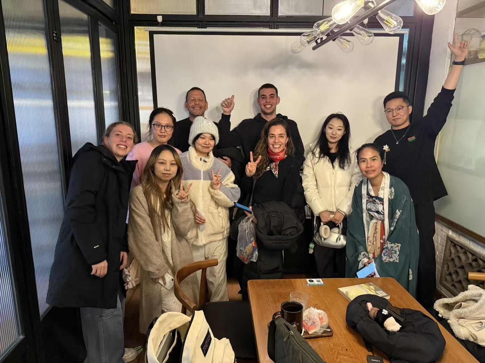
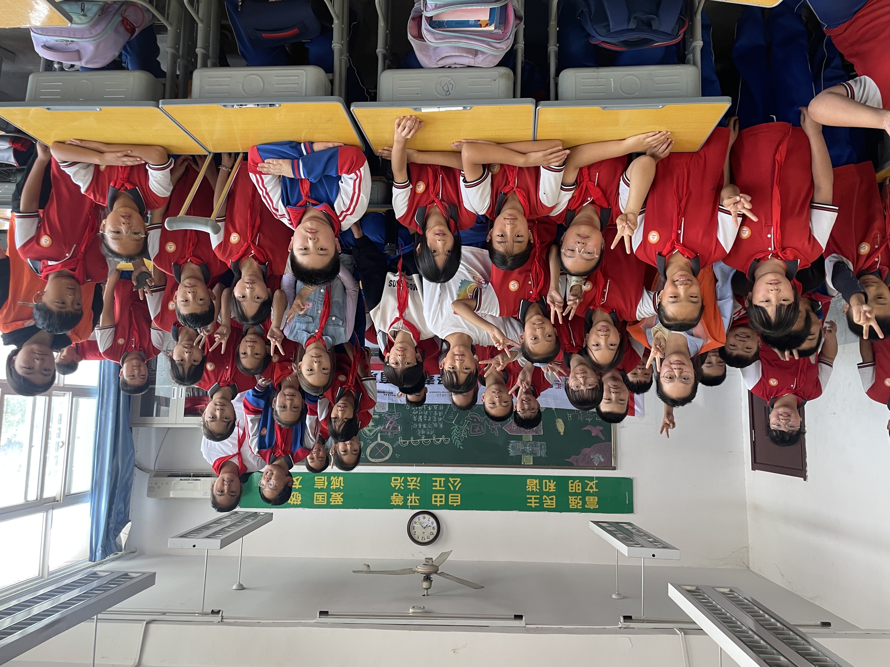
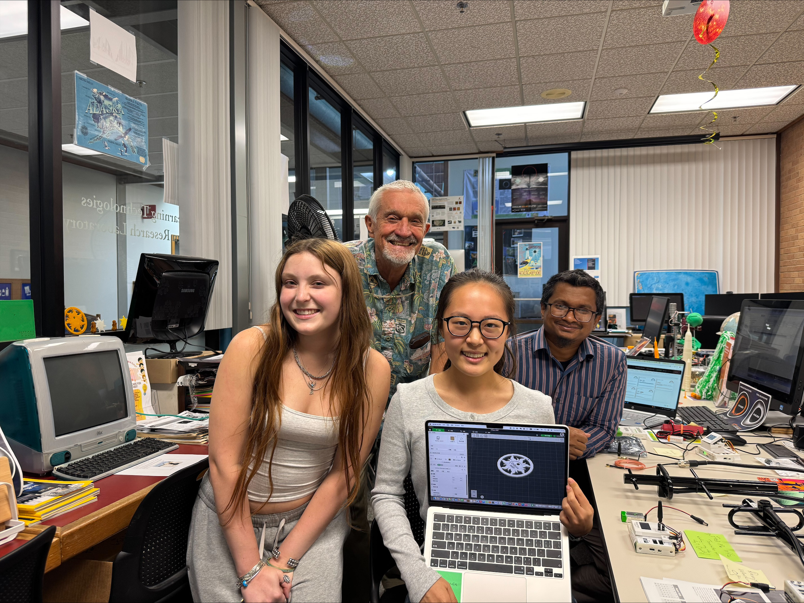

## About Me

Freshman majoring in Learning Technologies at the University of North Texas with experience in teaching, leadership, and cross-cultural communication. Interested in educational technology, AI, and 3D printing, with a focus on how emerging technologies can improve learning experiences. Brings strong communication, teamwork, and creativity through teaching, volunteer, and educational technology experiences, and is eager to continue developing skills in educational technology and research. 

## Education

**University of North Texas (UNT)**  
Bachelor of Science in Learning Technologies (In Progress)  
Denton, Texas, USA  
2026 – Present

## Research Interests

- **Educational Technology:** Technology-enhanced teaching and learning
- **Artificial Intelligence in Education:** Applications of AI in educational settings
- **Instructional Design:** Designing effective and engaging learning experiences
- **STEAM Education:** 3D printing, hands-on learning, and creative educational technologies

## Experience

### Undergraduate Lab Intern

**University of North Texas**  
*September 2026 – Present*

- Support 3D printing and educational technology projects under the guidance of Dr. Gerald Knezek.
- Prepare STL files, use slicing software, operate 3D printers, and assist with troubleshooting.
- Contribute to hands-on STEAM education activities.

### Co-founder, Xi'an Bilingual Corner

**Xi'an, China**  
*October 2025 – May 2026*

- Co-founded a bilingual cultural exchange community and organized more than seven cultural exchange events.
- Facilitated discussions in Chinese and English to promote cross-cultural communication and student engagement.

*Xi'an Bilingual Corner — Cultural Exchange Activity.*

### Volunteer English Teacher

**Village Primary School, Shaanxi, China**  
*March 2024 – April 2024*

- Taught English to 50 primary school students.
- Designed and delivered lessons to support language learning and student engagement.

*Volunteer English teaching at a village primary school in Shaanxi, China.*

## Projects

### 3D Printing and STEAM Education

As an Undergraduate Lab Intern at the University of North Texas, I support 3D printing and hands-on STEAM education activities. My work includes preparing STL files, using slicing software, operating 3D printers, and troubleshooting printed models.

*3D Printing Lab, University of North Texas.*
